# Kong AI Gateway for Claude

Claude shows up inside an organization in more than one product at
once — Claude Code on developer laptops, Claude Chat in the browser,
Cowork for team workflows — each authenticating to Anthropic on its own
terms. That's fine at small scale, but it leaves no single place to
answer questions like "which team is burning through Opus budget" or
"can we cut this contractor's access off today." Kong AI Gateway sits in
front of all of them as one policy point: it terminates every request on
its way to Anthropic, checks the caller's identity against your IdP, and
applies spend limits by group — all without the developer changing how
they invoke Claude Code, Chat, or Cowork.
Concretely, that means:

- **Gate** — every request must carry a valid, signed bearer token from
  your identity provider before it reaches a Claude model.
- **Budget** — spend limits are enforced per group, in dollars, computed
  from each model's real input/output token cost.

This walkthrough targets Kong AI Gateway 2.2 and is configured
declaratively with `kongctl`.

## Contents

- [Architecture](#architecture)
- [What you'll build](#what-youll-build)
- [Prerequisites](#prerequisites)
- [Steps](#steps)
  - [1. Create the control plane and deploy the gateway](#1-create-the-control-plane-and-deploy-the-gateway)
  - [2. Configure the vault](#2-configure-the-vault)
  - [3. Add Claude models](#3-add-claude-models)
  - [4. Enable SSO](#4-enable-sso)
  - [5. Add a usage dashboard](#5-add-a-usage-dashboard)
  - [6. Set spend limits](#6-set-spend-limits)
  - [7. Set up Claude Code](#7-set-up-claude-code)
- [Repo layout](#repo-layout)
- [Secrets](#secrets)

## Architecture


The control plane runs in Konnect; the data plane runs wherever you
choose (a laptop, your VPC, Kubernetes) and connects back over mTLS. This
is a **hybrid** deployment — Kong AI Gateway also supports fully
self-hosted and fully managed deployments if you need a different
posture.

## What you'll build

- One AI Gateway control plane that can expose the full Claude model
  catalog — Sonnet, Haiku, and Opus variants, plus Fable, including the
  5.5 generation (Opus 5.5, Sonnet 5.5, Haiku 5.5) and Fable 5.1 — behind a
  single `/anthropic` route, routed to Anthropic directly. You choose
  which models to expose; nothing here caps you to a fixed count.
- SSO in front of every model, via any OIDC-compliant identity provider.
  This walkthrough uses Okta, but the same steps work with Entra ID,
  Auth0, or anything else that speaks OIDC.
- Spend limits as their own, separate layer on top of that. Budgets can
  be scoped per consumer or per group, tracked in dollars (computed from
  each model's real cost) or in raw tokens, over whatever time window
  fits your use case. This walkthrough sets a cost-based budget per
  group, but the policy supports finer- or coarser-grained setups.

## Prerequisites

You'll need:

- A Kong Konnect account with AI Gateway enabled — [sign up for a
  free trial](https://cloud.konghq.com/register) if you don't have one.
- A Konnect **Personal Access Token** — profile menu → *Personal access
  tokens* → *Generate*.
- [`kongctl`](https://developer.konghq.com/kongctl/) 1.20.0 or newer,
  installed and on your `PATH`.
- An Anthropic API key with access to the models you plan to expose.
- `jq`, used by the vault bootstrap script.
- Docker. This walkthrough runs the data plane locally as a container;
  Kong AI Gateway's data plane also runs on a plain VM or inside
  Kubernetes if that fits your environment better.

Copy the env template and fill in the values above before starting:

```bash
cp .env.example .env
```

`kongctl` (the commands you'll run in every step below) doesn't read
`.env` on its own — it looks for two specific environment variables,
`KONGCTL_DEFAULT_KONNECT_PAT` and `KONGCTL_DEFAULT_KONNECT_REGION`. Load
your `.env` values into those before running any `kongctl apply`/`diff`
command:

```bash
set -a && source .env && set +a
export KONGCTL_DEFAULT_KONNECT_PAT="$KONNECT_TOKEN"
export KONGCTL_DEFAULT_KONNECT_REGION="$KONNECT_REGION"
```

Do this once per shell session — `scripts/bootstrap-vault.sh` (Step 2)
sets these for itself internally, but the `kongctl apply -f ...`
commands you run directly in Steps 1, 3, 4, and 6 need them exported
in your own shell.

### If you're using SSO

Step 4 adds SSO, and Step 6 uses the caller's group for spend limits.
Kong AI Gateway's OIDC auth strategy works with any OIDC-compliant
provider — this walkthrough uses Okta, but the same setup applies to Entra ID or others. If you want SSO,
set up your OIDC app before you get there:

1. Register an OIDC app with your provider (Web application,
   Authorization Code grant). See Okta's [OIDC app setup
   guide](https://developer.okta.com/docs/guides/implement-grant-type/authcode/main/)
   or Microsoft's [Entra ID app registration
   quickstart](https://learn.microsoft.com/en-us/entra/identity-platform/quickstart-register-app)
   for two worked examples.
2. Add your gateway's data-plane URL as an allowed redirect URI — this is
   what Konnect's own "Interactive sign-in" test flow uses. If you also
   want to test with a native client like Claude Desktop, add its loopback
   callback too: `http://localhost:8765/callback` — Claude Desktop listens
   on that port for the sign-in callback (see Step 4's "Test it with a real
   client").
3. Add a custom claim named `team` to the access token, with a value per
   user or group — this example expects `kong-premium` and
   `kong-standard`, which Step 6 uses to set spend limits
   by group.
4. Note the issuer URL, client ID, and client secret for `.env`.

If you don't need SSO, skip Step 4 and every model will be open
once Step 3 is applied. Kong AI Gateway also supports a `key-auth` auth
strategy, so you can still restrict access with simple API keys instead
of a full OIDC flow.

## Steps

Each step below applies one numbered YAML file (`1-gateway.yaml`,
`2-claude-integration.yaml`, and so on) with `kongctl apply -f <file>`.
These are declarative kongctl configs, not patches: every file is the
**full desired state** of the control plane for everything up to and
including that step, so `2-claude-integration.yaml` repeats everything
`1-gateway.yaml` created and adds the model provider and models on top,
`3-identity-provider.yaml` repeats that and adds the identity provider,
and so on. `kongctl apply` reconciles the live control plane to match the
file exactly — that's also why `git diff` between two consecutive step
files shows precisely what that step introduced, and why `kongctl diff
-f <file>` reports no changes once a file has already been applied (the
"Verify" line under each step below). Because the files are cumulative, a
`kongctl diff` on an earlier file only comes back clean right after you
apply it, not once a later step is live.

### 1. Create the control plane and deploy the gateway

Creates the AI Gateway control plane, then connects a data plane to
it so the gateway can actually proxy traffic.

```yaml
ai_gateways:
- ref: claude-tiered-gateway
  name: claude-tiered-gateway
  display_name: "Claude Gateway"
```

```bash
kongctl apply -f 1-gateway.yaml
```

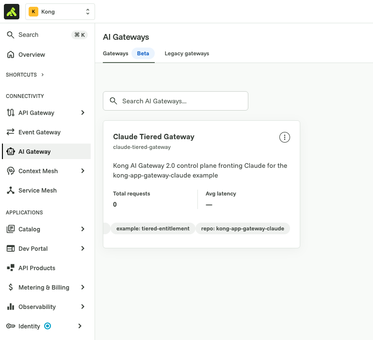

Then connect a data plane. Either use the Konnect UI (open the gateway →
**Data plane nodes** → **Configure data plane** → **Docker**, which
generates the `docker run` command for you), or do it from the CLI:

```bash
GW=$(kongctl get ai-gateway -o json | jq -r '.[] | select(.display_name=="Claude Gateway") | .id')
CP=$(kongctl get ai-gateway -o json | jq -r '.[] | select(.id=="'$GW'") | .endpoints.configuration' | sed 's|https://||')
TP=$(kongctl get ai-gateway -o json | jq -r '.[] | select(.id=="'$GW'") | .endpoints.telemetry' | sed 's|https://||')

# Generate a client certificate and register it with the control plane
openssl req -new -x509 -nodes -newkey rsa:2048 -subj "/CN=kong_clustering" \
  -keyout secrets/tls.key -out secrets/tls.crt -days 365
kongctl api post "/v1/ai-gateways/${GW}/data-plane-certificates" \
  title=local-dp "cert=$(cat secrets/tls.crt)"

docker run -d --name claude-aigw-dp -p 8000:8000 -p 8443:8443 \
  -e KONG_ROLE=data_plane \
  -e KONG_DATABASE=off \
  -e KONG_CLUSTER_MTLS=pki \
  -e KONG_CLUSTER_CONTROL_PLANE="${CP}:443" \
  -e KONG_CLUSTER_SERVER_NAME="${CP}" \
  -e KONG_CLUSTER_TELEMETRY_ENDPOINT="${TP}:443" \
  -e KONG_CLUSTER_TELEMETRY_SERVER_NAME="${TP}" \
  -e KONG_CLUSTER_CERT="$(cat secrets/tls.crt)" \
  -e KONG_CLUSTER_CERT_KEY="$(cat secrets/tls.key)" \
  -e KONG_LUA_SSL_TRUSTED_CERTIFICATE=system \
  kong/kong-ai-gateway:2.2.0
```

The data plane proxies traffic on `8000` (HTTP) and `8443` (HTTPS). It
shows as **Connected** in Konnect within a few seconds.

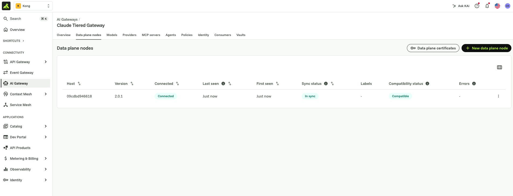

**Verify:** `kongctl diff -f 1-gateway.yaml` reports no changes.

### 2. Configure the vault

Every credential is referenced as `{vault://claude-gateway-vault/<key>}`,
never inlined. One command sets up the vault and seeds it from `.env`:

```bash
scripts/bootstrap-vault.sh
```

This creates a Konnect config store and vault (if they don't already
exist) and seeds the following keys. Re-run any time a value in `.env`
changes — it updates in place.

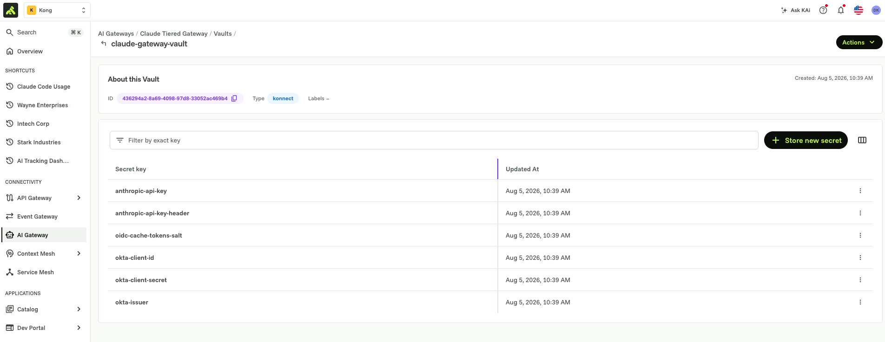

| Vault key | From `.env` |
|-----------|-------------|
| `anthropic-api-key` | `ANTHROPIC_API_KEY` |
| `anthropic-api-key-header` | `ANTHROPIC_API_KEY_HEADER` |
| `okta-issuer` | `OKTA_ISSUER` |
| `okta-client-id` | `OKTA_CLIENT_ID` |
| `okta-client-secret` | `OKTA_CLIENT_SECRET` |
| `oidc-cache-tokens-salt` | `OIDC_CACHE_TOKENS_SALT` |

Doing this before Step 3 means the model provider you add next can
reference `{vault://claude-gateway-vault/anthropic-api-key}` immediately,
instead of pointing at a secret that doesn't exist yet.

### 3. Add Claude models

Adds the model provider and one `ai_gateway_model` per Claude model, each
behind `/anthropic`, distinguished by the `model` field in the request
body.

Each provider holds the upstream credential:

```yaml
model_providers:
- ref: anthropic-direct
  type: anthropic
  config:
    auth:
      headers:
      - name: x-api-key
        value: "{vault://claude-gateway-vault/anthropic-api-key}"
```

Each model picks a target model id from the request body, and carries the
cost fields Step 6's spend limits are computed from:

```yaml
models:
- ref: claude-opus
  config:
    route:
      model:
        body_param: model
        values: [claude-opus-4-8]
  targets:
  - provider: anthropic-direct
    config:
      input_cost: 15   # USD / million input tokens
      output_cost: 75  # USD / million output tokens
```

`ai_gateway_model`s above only route inference calls (`POST`, matched on
the `model` field in the request body) — a model *list* request has no
body to match on, so `GET /anthropic/v1/models` needs its own agent
(a plain HTTP passthrough to Anthropic), plus a policy to inject the
Anthropic key on the way out. That policy sets the header both ways — `add` covers a caller that sends none,
`replace` overwrites one a caller already sent — so the real key always
wins either way:

```yaml
policies:
- ref: anthropic-add-key
  type: request-transformer-advanced
  config:
    add:
      headers:
      - "{vault://claude-gateway-vault/anthropic-api-key-header}"
    replace:
      headers:
      - "{vault://claude-gateway-vault/anthropic-api-key-header}"

agents:
- ref: anthropic-models-endpoint
  type: http
  config:
    url: https://api.anthropic.com/v1/models
    route:
      paths: [/anthropic/v1/models]
  policies:
  - anthropic-add-key
```

This is the unfiltered listing — the real Anthropic catalog. Step 4 puts
it behind SSO.

```bash
kongctl apply -f 2-claude-integration.yaml
```

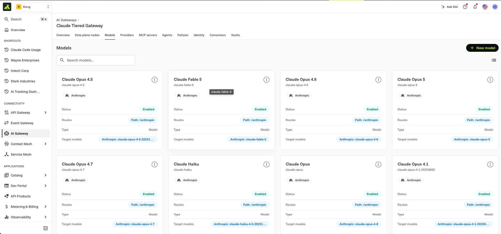

**Verify:** `kongctl diff -f 2-claude-integration.yaml` reports no
changes, and `curl http://localhost:8000/anthropic/v1/models -H "anthropic-version: 2023-06-01"`
returns the real Anthropic model catalog (Anthropic requires the
`anthropic-version` header). You can also test inference:

```bash
curl http://localhost:8000/anthropic/v1/messages \
  -H "content-type: application/json" -H "anthropic-version: 2023-06-01" \
  -d '{"model":"claude-haiku-5-5","max_tokens":50,"messages":[{"role":"user","content":"Say hi"}]}'
```

#### Test it with a real client

Point a Claude client's third-party inference settings at Kong instead of
Anthropic directly, to confirm inference and model discovery both work
end-to-end before any auth layers on top in Step 4:

| Setting | Value |
|---|---|
| Gateway base URL | `http://localhost:8000/anthropic` |
| Gateway API key | any placeholder value for now — Kong doesn't require one until Step 4 enables SSO; swap it for a real Okta-issued bearer token once that's applied |
| Gateway auth scheme | `x-api-key` |

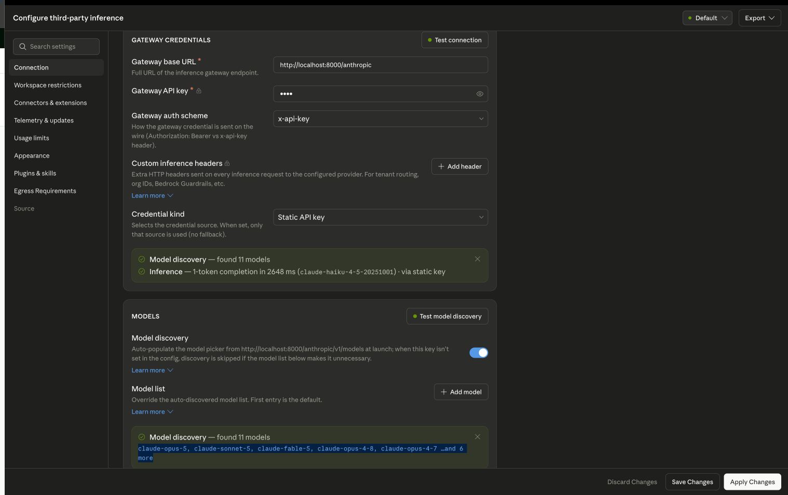

Both **Test connection** and **Test model discovery** should come back
green: model discovery lists the models from this step, and inference
round-trips a real completion through Kong to Anthropic and back.

### 4. Enable SSO

Requires a valid Okta-issued bearer token on every model and on model
discovery. Skip this step if you don't need SSO.

```yaml
auth_strategies:
- ref: okta-groups-idp
  type: openid-connect
  config:
    issuer: "{vault://claude-gateway-vault/okta-issuer}"
    client_id: ["{vault://claude-gateway-vault/okta-client-id}"]
    client_secret: ["{vault://claude-gateway-vault/okta-client-secret}"]
    cache_tokens_salt: "{vault://claude-gateway-vault/oidc-cache-tokens-salt}"
    auth_methods: [bearer, authorization_code]
    scopes: [openid]
    consumer_groups_claim: [team]   # maps the Okta `team` claim to a consumer group
    consumer_optional: true

consumer_groups:
- name: kong-premium
- name: kong-standard
```

Every model, and the `anthropic-models-endpoint` agent from Step 3,
references the strategy with `access.auth_strategies: [okta-groups-idp]`.

```bash
kongctl apply -f 3-identity-provider.yaml
```

**Verify:** without a token, `GET /anthropic/v1/models` redirects (302) to
your Okta authorization endpoint, and a request to `/anthropic/v1/messages`
with an invalid bearer token returns `401 Unauthorized`.

#### Test it with a real client

The static-key setup from Step 3's client test now fails, since every
model and the model-discovery agent require a valid Okta token and a
dummy key isn't one.

To get a real token, switch the client from a static key to interactive
OIDC sign-in instead. In Claude Desktop's third-party inference settings:

1. **Credential kind**: change from `Static API key` (Step 3) to
   `Identity provider sign-in (OIDC)`.
2. **Gateway base URL**: same as before — `http://localhost:8000/anthropic`.
3. **Sign-in session lifetime**: how long a sign-in stays valid before the
   client shows a re-authenticate banner (its own timer, independent of
   Kong's session handling) — e.g. `60000` seconds.
4. **Identity provider sign-in flow**: `browser` (the system browser).

   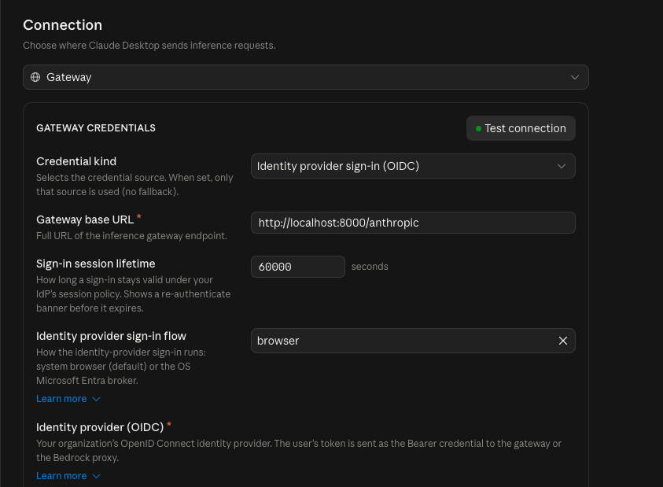
5. **Identity provider (OIDC)**:
   - **Client ID**: your `OKTA_CLIENT_ID`.
   - **Issuer URL**: your Okta issuer's **base** URL, e.g.
     `https://<your-okta-domain>/oauth2/default` — **not** the full
     `/.well-known/openid-configuration` discovery URL. This is different
     from the `okta-issuer` vault value, which Kong's `openid-connect`
     auth strategy needs in the full discovery-URL form; the client
     derives the discovery document itself from the base issuer.
   - **Bearer token**: `Access token` — matches the `bearer` entry in
     `auth_methods` above, which validates an OAuth access token.
   - **Scopes**: the scope your Okta authorization server issues for this
     app — `claude-access` in this example.
   - **Append offline_access**: **on** — so the IdP returns a refresh
     token for silent renewal.
   - **Redirect port**: `8765`, and **Redirect host**: `localhost`. The
     client opens your browser for login and listens on this local port
     for the callback, so `http://localhost:8765/callback` must be a
     registered redirect URI in Okta (see Prerequisites).
   - **Additional redirect referrer hosts**: leave as the default
     (authorization URL host only) unless Okta completes sign-in from a
     different host than the authorization URL's.

   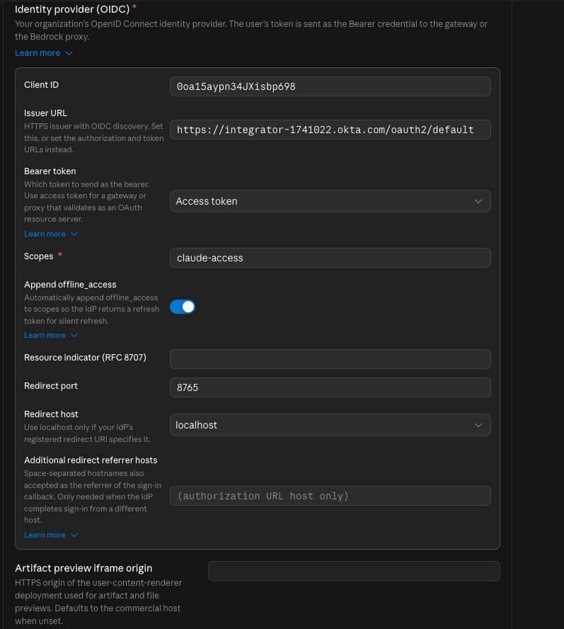
6. Custom inference headers aren't needed for this step.
7. Click **Test connection** — you'll be redirected to log in: the client
   opens your browser and sends you to Okta to sign in (including MFA, if
   your org requires it). Once you complete sign-in, **Test connection**
   shows green with an inference result "via identity provider", using the
   real access token instead of the static key.

   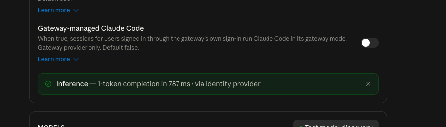
8. Click **Test model discovery**. It returns every model the gateway
   exposes — 14 here — through the same token.

   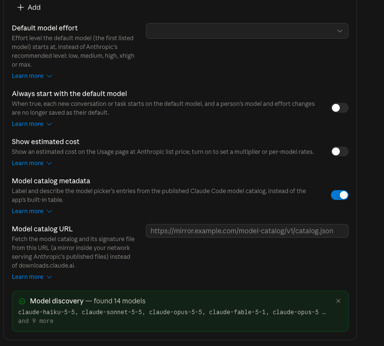

### 5. Add a usage dashboard

`5-dashboard.json` holds a Konnect Analytics dashboard for cost, token,
and request visibility across models and consumers. Import it from the
Konnect UI (**Analytics** → **Dashboards** → **Import**), or apply it via
the API once you're ready to automate it.

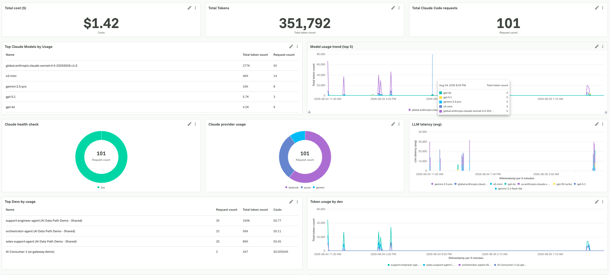

### 6. Set spend limits

Adds a cost-based budget per group, computed from each model's
`input_cost`/`output_cost` — not a token count, since the models span
a wide price range.

```yaml
policies:
- ref: tiered-cost-budget
  type: ai-rate-limiting-advanced
  config:
    identifier: consumer-group   # budget by group, not by consumer
    policies:
    - match:
      - type: consumer_group
        values: [kong-premium]
      window_type: sliding
      limits:
      - limit: 5.0          # USD per window, not tokens
        window_size: 60     # seconds
        tokens_count_strategy: cost
    # kong-standard follows the same shape, limit: 1.0
```

The policy is attached to every model with `policies: [tiered-cost-budget]`.
Budget counters are per data plane (`strategy: local`); switch to Redis for
a shared budget across several data planes.

```bash
kongctl apply -f 6-rate-limiting-policy.yaml
```

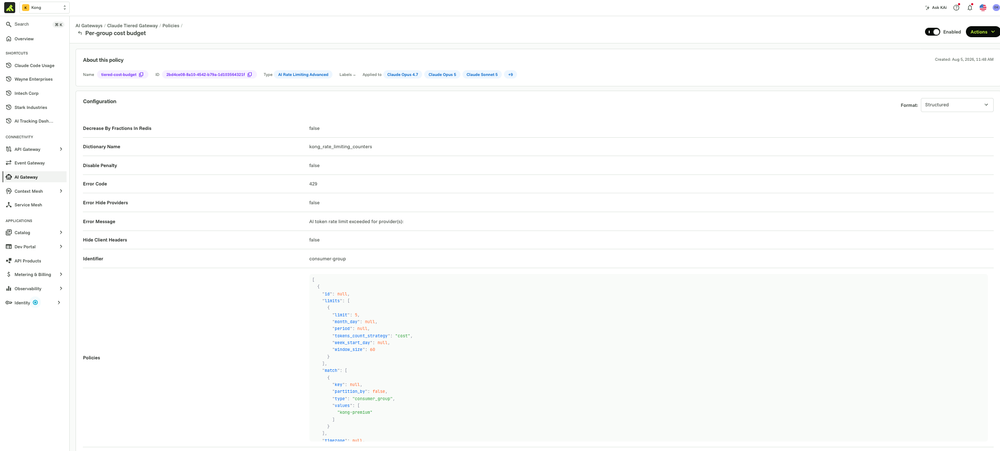

**Verify:** `kongctl diff -f 6-rate-limiting-policy.yaml` reports no
changes.

### 7. Set up Claude Code

Points Claude Code at the gateway and signs you in with Okta — the same
SSO as Claude Desktop in Step 4, so the requests carry your `team` claim
and count against your group's budget from Step 6. This step changes
nothing in Kong or Okta; it only configures your computer. It's based on
Kong's [Claude Code SSO
cookbook](https://developer.konghq.com/cookbooks/claude-code-sso/).

Claude Code can't run an OIDC login on its own, so it calls a small helper
script (an [`apiKeyHelper`](https://docs.claude.com/en/docs/claude-code/settings))
whenever it needs a credential. The helper,
[`scripts/okta-claude-auth.sh`](scripts/okta-claude-auth.sh), signs you in
through your browser, caches the token, and refreshes it silently.

**Before you start**
- Steps 1–4 are done and the data plane is running (`docker ps` shows
  `claude-aigw-dp`).
- [Claude Code](https://docs.claude.com/en/docs/claude-code/overview) is
  installed (`claude --version` works).
- Your `.env` has `OKTA_ISSUER` and `OKTA_CLIENT_ID` (already set from
  Step 2).
- `http://localhost:8765/callback` is a registered redirect URI in Okta
  (already done for Claude Desktop in Step 4). The helper reuses that port,
  so close Claude Desktop's sign-in window first if it's open.

**Set up**

```bash
scripts/setup-claude-code.sh
```

This copies the helper to `~/.claude/okta-claude-auth.sh` and merges the
settings below into `~/.claude/settings.json`. Your existing settings are
kept, with a backup at `~/.claude/settings.json.bak`.

```json
{
  "apiKeyHelper": "~/.claude/okta-claude-auth.sh",
  "env": {
    "ANTHROPIC_BASE_URL": "http://localhost:8000/anthropic",
    "OKTA_DOMAIN": "https://<your-okta-domain>",
    "OKTA_CLIENT_ID": "<your client id>",
    "OKTA_AUTH_SERVER": "default",
    "OKTA_SCOPES": "openid claude-access offline_access",
    "ANTHROPIC_MODEL": "claude-sonnet-5-5",
    "ANTHROPIC_DEFAULT_SONNET_MODEL": "claude-sonnet-5-5",
    "ANTHROPIC_DEFAULT_OPUS_MODEL": "claude-opus-5-5",
    "ANTHROPIC_DEFAULT_HAIKU_MODEL": "claude-haiku-5-5",
    "CLAUDE_CODE_DISABLE_EXPERIMENTAL_BETAS": "1"
  }
}
```

The Okta values go in `env` because Claude Code runs the helper with a
clean environment. The model settings map Claude Code's Sonnet, Opus and
Haiku to models you registered in Step 3 — change them to any model id the
gateway serves. `CLAUDE_CODE_DISABLE_EXPERIMENTAL_BETAS` strips beta
fields that only Anthropic's own API accepts.

**Run it**

```bash
unset ANTHROPIC_API_KEY ANTHROPIC_AUTH_TOKEN   # either one bypasses the helper
claude
```

The first request opens your browser to sign in with Okta. After that the
token is cached in `~/.claude/okta-cache/` and refreshed automatically, so
you only sign in again when the refresh token expires. Ask Claude Code
something, then confirm the request went through the gateway — it shows up
in the Konnect dashboard from Step 5.

**Troubleshooting**
- *Browser doesn't open* — the helper prints the sign-in URL; paste it
  into a browser.
- *Okta shows "Bad Request"* — the redirect URI isn't registered, or the
  `claude-access` scope isn't allowed for the app. Both must match Step 4.
- *`401 Unauthorized` from the gateway* — delete the cache
  (`rm -rf ~/.claude/okta-cache`) and sign in again.
- *Claude Code ignores the gateway* — an API key is set in your shell or
  `ANTHROPIC_BASE_URL` is overridden elsewhere; run `unset
  ANTHROPIC_API_KEY ANTHROPIC_AUTH_TOKEN` and check `claude` again.
- *Undo* — restore `~/.claude/settings.json.bak`.

## Repo layout

```
├── README.md
├── .env.example                    # copy to .env and fill in
├── 1-gateway.yaml                   # Step 1
├── 2-claude-integration.yaml        # Step 3
├── 3-identity-provider.yaml         # Step 4
├── 5-dashboard.json                 # Step 5
├── 6-rate-limiting-policy.yaml      # Step 6
├── scripts/
│   ├── bootstrap-vault.sh           # Step 2
│   ├── setup-claude-code.sh         # Step 7
│   └── okta-claude-auth.sh          # Step 7 — Claude Code sign-in helper
├── images/                          # console screenshots
└── secrets/                         # local-only staging for real credentials (git-ignored)
```

## Secrets

Nothing in this repo ever holds a real credential. `.env` and everything
under `secrets/` are git-ignored — see
[`secrets/README.md`](secrets/README.md). Every `*.yaml` file references
secrets as `{vault://claude-gateway-vault/<key>}`, resolved by Kong at
request time.
